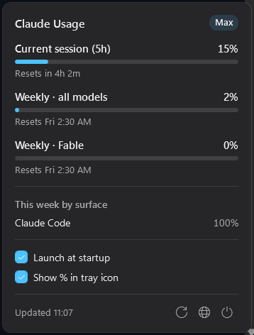

# Pace

Pace sits in your Windows tray and tells you how much of your Claude plan you've used. One click shows your 5-hour session, your weekly limits and when each one resets. Click away and it's gone.



## Download

Grab the latest version from the [Releases page](https://github.com/ayushgade06/pace/releases/latest). There are two builds, and they do the same thing:

| File | Size | Use it if |
|---|---|---|
| [`Pace-win-x64.exe`](https://github.com/ayushgade06/pace/releases/latest/download/Pace-win-x64.exe) | 72 MB | You just want it to work. Nothing else to install. |
| [`Pace-win-x64-small.exe`](https://github.com/ayushgade06/pace/releases/latest/download/Pace-win-x64-small.exe) | 250 KB | You already have the [.NET 10 Desktop Runtime](https://dotnet.microsoft.com/download/dotnet/10.0). |

Pace isn't code signed yet, so Windows may show "Windows protected your PC" the first time. Click **More info**, then **Run anyway**.

You'll also need [Claude Code](https://claude.com/claude-code) installed and logged in with your Claude subscription. Pace uses that login, so there's nothing to set up.

## What you get

- Your current session (5h) and weekly usage, each with a progress bar and a reset countdown
- Per-model weekly limits when your plan has them (Opus, Sonnet and others)
- A breakdown of this week's usage by surface, like Claude Code or chat
- Your plan (Pro, Max) and when the numbers were last updated
- A tray icon showing your session percentage. It turns amber at 70%, red at 90% and gray if the data is out of date
- Automatic refresh every 5 minutes, plus a refresh button that updates right away
- Starts with Windows (you can turn this off in the popover)
- Matches your Windows dark or light theme and accent color

On Windows 11, new tray icons start out hidden behind the **^** arrow. Drag Pace onto the taskbar to keep it in view.

## How it works

Claude Code keeps its login in `%USERPROFILE%\.claude\.credentials.json`. Pace reads that file (it never changes it) and asks `api.anthropic.com` for your usage, the same way Claude Code's `/usage` command does. It doesn't run a model and doesn't spend any of your usage.

If the login has expired, Pace will ask you to open Claude Code once. Claude Code renews it and Pace picks it up on the next refresh. Pace never renews the login itself, because that would sign Claude Code out.

## Privacy

- Your login token only ever goes to `api.anthropic.com` over HTTPS. Redirects are blocked, so it can't end up anywhere else.
- Pace doesn't log, show or save your token.
- The only things it stores are two settings in `%LOCALAPPDATA%\Pace\settings.json` and a startup entry in the registry.
- No analytics and no other network traffic.

## Build it yourself

You'll need the .NET 10 SDK.

```powershell
git clone https://github.com/ayushgade06/pace
cd pace
dotnet run --project src/Pace
dotnet test
```

To make your own exe:

```powershell
dotnet publish src/Pace -c Release -r win-x64 --self-contained -p:PublishSingleFile=true -p:EnableCompressionInSingleFile=true -o publish
```

[ARCHITECTURE.md](ARCHITECTURE.md) explains how the code is laid out, and [DEVELOPMENT.md](DEVELOPMENT.md) covers testing.

## Good to know

- The usage endpoint isn't officially documented, so it could change. If Pace stops working after an update, that's the likely reason.
- Pace has only been tested on a single monitor with the taskbar at the bottom, in dark mode. Other setups should work, but haven't been checked yet.

Pace isn't affiliated with Anthropic. MIT License.
